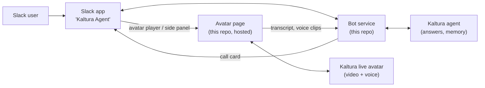

# Kaltura conversational agent and live avatar in Slack

**Overview** · [How it works](docs/HOW-IT-WORKS.md) · [Replicate & reuse](docs/REPLICATE-AND-REUSE.md) · [Caveats, risks & limits](docs/CAVEATS-AND-RISKS.md) · [Technical reference](docs/TECHNICAL-REFERENCE.md)

---

A working prototype that brings a **Kaltura conversational agent**, including its **live video avatar**, into Slack. Users chat with the agent in Slack, play the avatar inside the conversation, talk to it with Slack voice clips or a hands-free live call, and keep a transcript in Slack. Built with Kaltura's Intelligent Agents SDK and Slack's agent, Block Kit, Work Objects and Calls APIs.

> **Status:** prototype, tested by hand in one Slack workspace plus 45 automated tests. Not production-ready. See [Caveats, risks & limits](docs/CAVEATS-AND-RISKS.md).

## What a user can do

| In Slack | What happens |
|---|---|
| **Message the agent** (DM or @mention) | Answers appear as they are written, with Kaltura video clips, sources, follow-up buttons and 👍/👎 feedback. No extra threads. |
| **Open the agent DM** | A "Talk with me live" message waits there: the avatar player, a **Start a live call** button, and a side-panel card. |
| **Press play on the avatar** | The live avatar plays **inside the Slack message**. Type under the video and the avatar answers out loud. |
| **Click the card** | The avatar opens in Slack's **side panel**, beside the conversation. |
| **Record a Slack voice clip** | Slack transcribes it; the open avatar answers out loud (or the agent answers in text if no avatar is open). |
| **Start a live call** or `/talk` | A hands-free voice call with the avatar in a browser window, shown in Slack as a native call card. |
| **Read the transcript** | Everything said to the avatar is written into one "📝 Avatar conversation" message in the DM. |

Text chat and the avatar share **one conversation memory**: the avatar knows what was typed in the chat, and the other way round.

## Where to read next

| If you want to… | Read |
|---|---|
| Understand the parts, how they connect, and why it was built this way | [How it works and how it was built](docs/HOW-IT-WORKS.md) |
| Set it up again, demo it for a customer, or reuse it for another agent | [Replicate & reuse](docs/REPLICATE-AND-REUSE.md) |
| Know what can't be done, what's risky, and what's needed for production | [Caveats, risks & limits](docs/CAVEATS-AND-RISKS.md) |
| Developer details: files, settings, endpoints, tests | [Technical reference](docs/TECHNICAL-REFERENCE.md) |

## The one-picture version



## The most important limits (details in [Caveats](docs/CAVEATS-AND-RISKS.md))

- **No live microphone inside Slack.** Slack doesn't give any app's content microphone access, and apps can't join huddles. Speech goes through Slack voice clips, or through a live call that opens in a browser window (the same way Zoom and Meet work in Slack).
- **The in-message player restarts when the conversation scrolls**, for example when a new message arrives. Press play again; the side panel doesn't have this issue.
- **Today it runs on a developer's laptop** with a temporary tunnel, and serves one Slack workspace. Customers need hosting, an "Add to Slack" install, and Slack Marketplace approval.

## Quick start (developers)

```bash
npm install
cp .env.example .env   # fill in Slack and Kaltura settings
npm test               # 45 tests, no accounts needed
npm start
```
Full setup, including the Slack app, the Kaltura agent and hosting, is in [Replicate & reuse](docs/REPLICATE-AND-REUSE.md).
