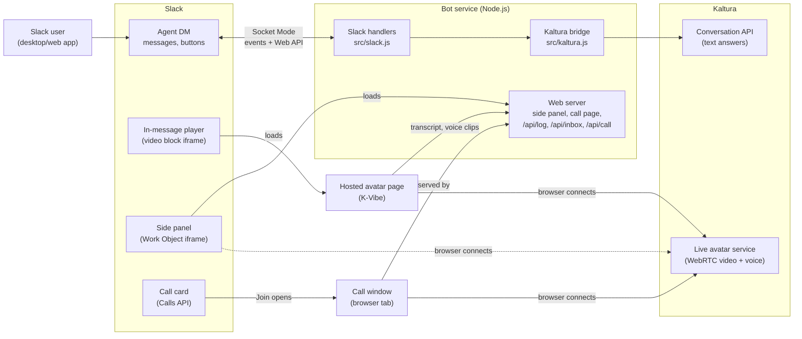
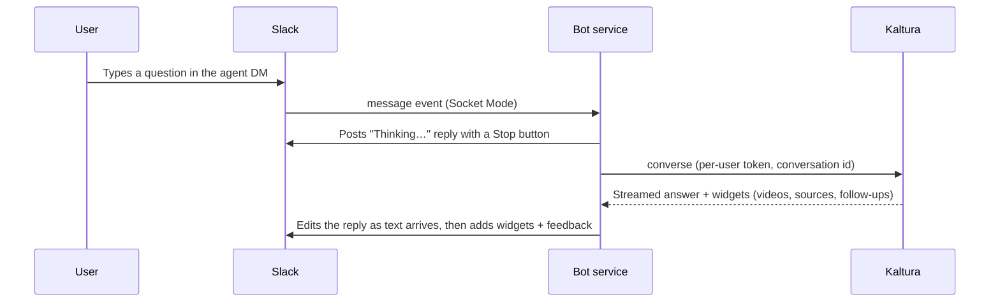
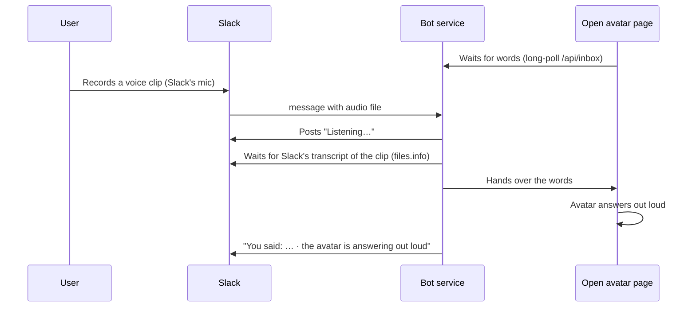

# How it works and how it was built

[← Back to overview](../README.md) · **How it works** · [Replicate & reuse](REPLICATE-AND-REUSE.md) · [Caveats, risks & limits](CAVEATS-AND-RISKS.md) · [Technical reference](TECHNICAL-REFERENCE.md)

---

## In one paragraph

A Slack app ("Kaltura Agent") connects Slack to a **Kaltura conversational agent**. Text questions are answered as Slack messages, with videos, sources and follow-up buttons. A **live video avatar** of the same agent can be played inside the Slack conversation (in the message itself or in Slack's side panel), where the user types and the avatar answers out loud. Speech works in two ways: Slack's own **voice clips** (answered out loud by the open avatar) and a hands-free **live call** that Slack shows as a native call card and runs in a browser window. Everything the user says to the avatar is written back into the Slack conversation, and text chat and avatar share the same conversation memory.

## The building blocks

| Part | What it is | Where it runs today |
|---|---|---|
| **Slack app "Kaltura Agent"** | A Slack app created from [`manifest.json`](../manifest.json): agent view, permissions, `/talk` command, call support, link and embed settings. | Slack (configured in api.slack.com) |
| **Bot service** (`src/`) | A Node.js program. Listens to Slack (Socket Mode, no public URL needed for chat), talks to Kaltura, posts and edits Slack messages, and serves the avatar side panel and call pages. | This developer's Mac, during the prototype |
| **Public HTTPS address** | Slack and browsers need to reach the bot service's pages (side panel, call page, transcript and voice-clip endpoints). | A temporary Cloudflare tunnel (`*.trycloudflare.com`) |
| **Hosted avatar page** (`kvibe/`) | The page that plays the avatar inside a Slack message. Slack only plays pages from domains the app registered, so it is hosted on a Kaltura domain. | Kaltura K-Vibe (internal demo hosting), public, unlisted |
| **Kaltura agent** | The "brain" (intellect: prompts, knowledge, tools) plus the avatar (face, voice). Created with the Kaltura Intelligent Agents SDK. | Kaltura cloud |
| **Kaltura Intelligent Agents SDK** | `@kaltura/intelligent-agents`, Kaltura's JavaScript SDK. Server side: tokens and the text conversation API. Browser side: the live avatar (WebRTC video, voice). | Inside the bot service and the avatar pages |

## Architecture

**Two separate paths to Kaltura:**
1. **Text** goes server to server: Slack → bot service → Kaltura conversation API → back into Slack. The user's browser is not involved.
2. **The live avatar** runs in the user's browser (or Slack's frame): the avatar page gets a short-lived Kaltura token from the server, then connects straight to Kaltura's avatar service for video and voice.

Both use the **same Kaltura conversation (thread)** for a given Slack user and conversation, so the agent remembers what was said in either.

## What the user experiences, and what happens behind it

### 1. Text chat

- Replies are **top-level** next to the user's message (no thread), edited live. Inside a thread, Slack's native agent streaming is used instead.
- Kaltura "widgets" become Slack blocks: video clips → playable video blocks, sources → links, follow-ups → buttons, flashcards → "Show answer" buttons.
- Thumbs up/down are saved as Kaltura message feedback.

### 2. The avatar inside the conversation
- When the user opens the agent DM, the app makes sure one **"Talk with me live"** message is there: an in-message avatar player, a **Start a live call** button, and a side-panel card. It is refreshed in place, never reposted.
- **In-message player:** a Slack *video block* whose "video" is the hosted avatar page. Slack plays it inside the message (about 350×260). The page starts the avatar automatically, the user types under the video, and the avatar answers out loud.
- **Side panel:** a Slack *Work Object* card. Clicking it opens Slack's side panel with the avatar page (served by the bot service).
- Every link to the avatar is **signed** (HMAC) and short-lived. It names the Kaltura user and conversation, so the avatar continues the same conversation as the text chat.

### 3. Voice clips answered by the avatar

- Slack never gives an app's page the microphone, so speech comes in through Slack's own voice clips and Slack's own transcription.
- If no avatar is open, the clip is answered in text instead.

### 4. Live hands-free call
- **Start a live call** (or `/talk`) opens the call page in a browser window. When it connects, the bot registers a Slack **call** and posts its card in the DM ("Live call with the Kaltura avatar · started… · who joined"). **End call** closes the card ("Ended at… · lasted…").
- In the call window the microphone stays open (no push-to-talk) and the user can interrupt the avatar. **Mute** and **Float over Slack** (an always-on-top mini window, Chrome/Edge) are available.

### 5. Transcript back in Slack
- No captions are drawn over the video. Each exchange (what the user said or typed + the avatar's answer) is written into one **📝 Avatar conversation** message in the DM.
- That message is **edited**, not reposted: Slack reloads the in-message player whenever the conversation scrolls (and a new message scrolls it), but not when a message is edited. The transcript message is created before the player is used, and only edited afterwards.

## Key design decisions (and why)

| Decision | Why | What was rejected |
|---|---|---|
| **Socket Mode** for Slack events | No public URL or firewall work needed for the chat part. | HTTP events endpoint (needs public hosting from day one). |
| **Server-side Kaltura text API** for chat | Slack messages can't host a web chat widget; the SDK's headless `converse` API returns text and widgets that map to Slack blocks. | Embedding Kaltura's web chat UI (not possible in Slack messages). |
| **One Kaltura user per Slack user** (`slack-<team>-<user>`) and per-user tokens | Private conversations, per-user memory and feedback; the admin secret never leaves the server. | A shared token (everyone would share one identity). |
| **Top-level replies, edited live** (default) | Product ask: no extra threads. Slack's streaming and "Working…" status only work inside threads, so a placeholder reply is edited instead. | Always threading (still available: `SLACK_THREAD_REPLIES=1`). |
| **Avatar page hosted on a Kaltura domain** (K-Vibe) | Slack only plays pages from the app's registered link domains, and the page must be public (Slack's player can't sign in). | A temporary tunnel domain (worked for the side panel, but its address changes and it is not a customer-grade host). |
| **Signed links** for every avatar page | The page mints a Kaltura token for a specific user; links must not be forgeable. Short expiry (10 min panel, 12 h in-message/call). | Unsigned links or long-lived tokens in pages. |
| **Voice via Slack clips + a separate call window** | Slack blocks microphone access for all app content, and apps can't join huddles. | Microphone inside Slack (impossible), a browser helper tab or a Mac menu-bar helper (rejected by product: extra end-user steps). |
| **Transcript in one edited message** | New messages reset the in-message player; edits don't. | One message per exchange (tested: it reset the avatar after every answer). |
| **Same page code for all avatar views** (`src/avatar-page.js`) | One place to change behavior; the K-Vibe copy is generated from it. | Separate copies that drift apart. |

## How it was built (the path, and what each step taught us)

The prototype was built in one working session, step by step, each tested in the real Slack workspace.

1. **Research.** Read Slack's AI/agent docs, the Kaltura Intelligent Agents SDK and kaltura.md. Finding: Slack offers agent surfaces, streaming and buttons, but no way to embed a web UI in messages, except Work Object embeds (side panel) and video blocks.
2. **Prototype with a fake agent.** Bot service, Kaltura bridge, Slack block mapping, avatar page, tests, all against a mock Kaltura agent first.
3. **Real Kaltura agent.** Created a Kaltura avatar agent with the SDK's `provision` call. Verified text answers, conversation memory and the live avatar in a browser.
4. **Real Slack app.** Created from the manifest, installed in the Kaltura workspace. Verified streamed answers, buttons and the side-panel avatar.
5. **Thread-free conversation.** Product asked for no extra threads; replies switched to top-level messages edited live.
6. **Avatar inside the message.** Discovered that Slack's video block plays an embedded page inline. It needed a registered domain, so the avatar page was moved to K-Vibe. Learned that **every change to link domains requires reinstalling the Slack app**, and that the K-Vibe app had to be made public (admin approval).
7. **New face and voice** for the avatar from a supplied photo (`scripts/set-avatar-photo.mjs`).
8. **Speech.** Confirmed in Slack that app frames get no microphone (panel: `allow-scripts allow-forms`; in-message player: autoplay only). Added Slack voice clips (with Slack's transcript), then a live call through Slack's Calls API, then voice clips answered out loud by an open avatar.
9. **Transcript in Slack.** Removed captions from the video, logged exchanges into Slack. Discovered that new messages reset the in-message player; switched to one edited transcript message.

## Security model (summary)

- **Secrets stay on servers:** the Kaltura admin secret and the Slack tokens are only in the bot service's `.env` (and the admin secret in the K-Vibe app's settings). Browsers get short-lived, per-user Kaltura user tokens.
- **Signed links:** avatar pages accept only links signed with `EMBED_SIGNING_SECRET`, and only until they expire.
- **Signed transcript keys:** the transcript and voice-clip endpoints accept only keys signed by the app, which name the Slack conversation.
- **Frames:** pages set `frame-ancestors` so only Slack can frame them.

See [Caveats, risks & limits](CAVEATS-AND-RISKS.md) for what this does not yet cover.
